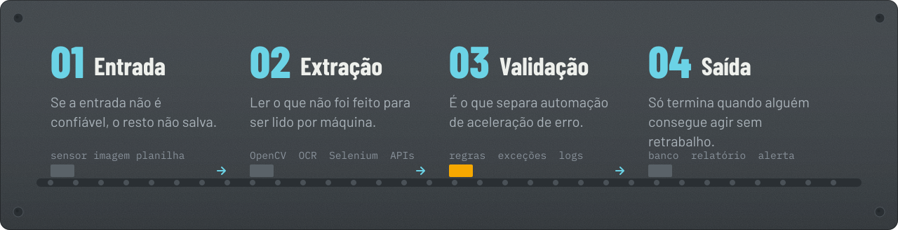
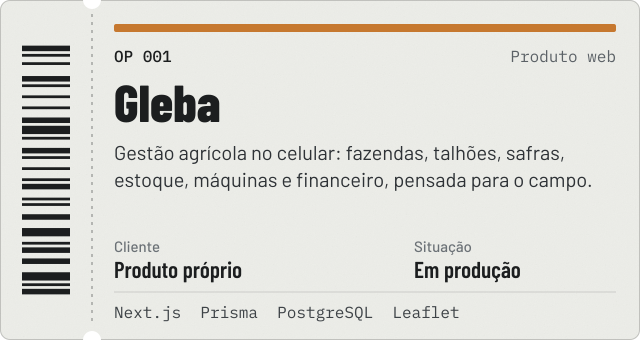
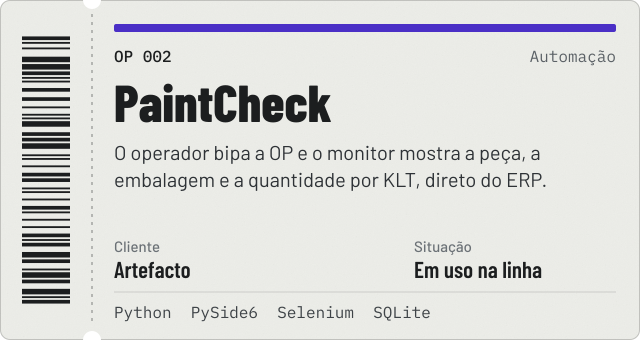
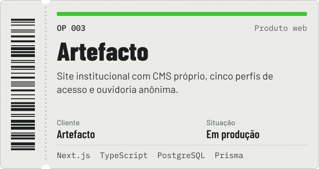
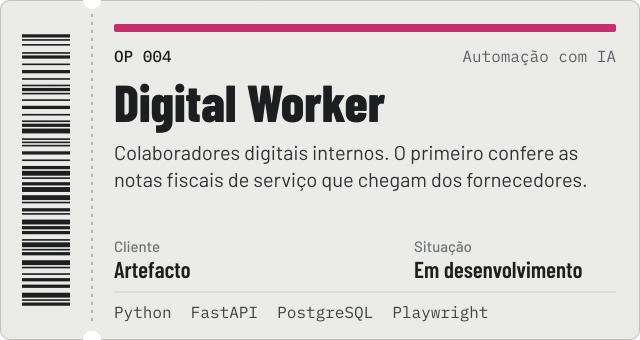
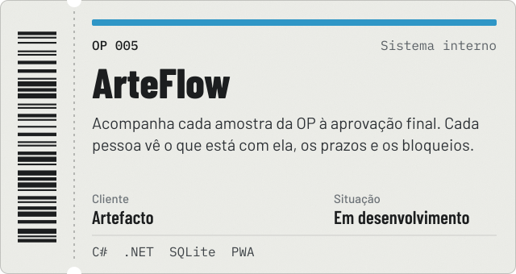
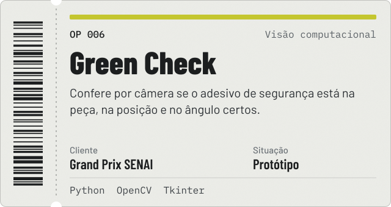

  

Estudo Engenharia de Software na FIAP e trabalho com o que fica entre o processo e o código: entender como uma tarefa é feita hoje, achar onde o esforço é desperdiçado e entregar software que resolve aquilo de forma confiável.

Hoje desenvolvo sistemas internos e automações na **Artefacto**, metalúrgica e madeireira de Horizontina (RS) que fornece componentes para John Deere, AGCO e Stara. Por isso boa parte do meu trabalho conversa com ERP, linha de produção e chão de fábrica, e não só com navegador.

## Como eu trabalho

Todo projeto de automação passa por essas quatro etapas. A que mais importa é a validação: um dado que não passa na regra vira exceção sinalizada, nunca uma gravação silenciosa que ninguém percebe.

## Projetos

A maior parte do que construo roda dentro de empresa e fica em repositório privado. Os detalhes de cada um estão no [portfólio](https://www.juniorportfolio.blog/projetos).

  
  

  
  

  
  

**Gleba** é o meu produto. Gestão de fazenda feita para o celular, no talhão, com internet instável: mapa dos talhões com importação KML/KMZ, operações com baixa automática de insumos no estoque e custo real por safra. Está no ar em [glebaagro.com.br](https://glebaagro.com.br).

**PaintCheck** tirou o operador da tela do ERP. Ele bipa o código de barras da OP com o leitor que já existia na linha, e um monitor em tela cheia mostra a peça, o tipo de embalagem e a quantidade por KLT. Funciona sem rede e se recupera sozinho depois de uma queda de energia.

**Artefacto** é o site da empresa com painel próprio: marketing, RH, compliance e comercial cuidam do seu conteúdo e cada um enxerga só o que lhe cabe. A ouvidoria gera protocolo aleatório e a consulta pública devolve só o status, nunca o conteúdo da denúncia. No ar em [artefacto.ind.br](https://artefacto.ind.br).

**Digital Worker** é uma plataforma de colaboradores digitais com API em FastAPI, painel web e automação do ERP com Playwright. O primeiro processo confere as notas fiscais de serviço recebidas. A fase atual é só de leitura: nada é gravado no ERP até a conferência estar provada.

**ArteFlow** acompanha solicitações de amostra por todas as etapas, da ordem de produção à aprovação da qualidade. Roda num servidor local da fábrica e cada pessoa instala o painel como aplicativo (PWA), com prazos, atrasos e e-mails automáticos.

**Green Check** foi feito em equipe para o Grand Prix SENAI de Inovação, num desafio da John Deere. Com OpenCV, compara a imagem da peça com um padrão e responde se o adesivo de segurança está lá, dentro da tolerância de posição e rotação.

### Outros

- **Automação de Amostras**: aplicativo desktop em Python que limpa os relatórios exportados do ERP Tecnicon e mostra em que setor cada amostra está parada.
- **BriqueFácil**: marketplace de carros das revendas do RS, com busca em linguagem natural (em desenvolvimento).
- **[Portfólio](https://github.com/JuniorSchmid/portfolio)**: este site, em Next.js, TypeScript e GSAP.

## Ferramentas

| Área | Tecnologias |
|---|---|
| Linguagens | Python, TypeScript, JavaScript, C#, SQL, PHP |
| Automação e visão | OpenCV, Selenium, Playwright, OCR, PySide6 |
| Web | Next.js, React, Node.js, FastAPI, Tailwind CSS |
| Dados | PostgreSQL, Prisma, SQLite, MySQL |
| Ferramentas | Git, GitHub, Vercel |

## Contato

[Portfólio](https://www.juniorportfolio.blog) · [LinkedIn](https://www.linkedin.com/in/juniorschmid) · [juniorschmid22@gmail.com](mailto:juniorschmid22@gmail.com)
